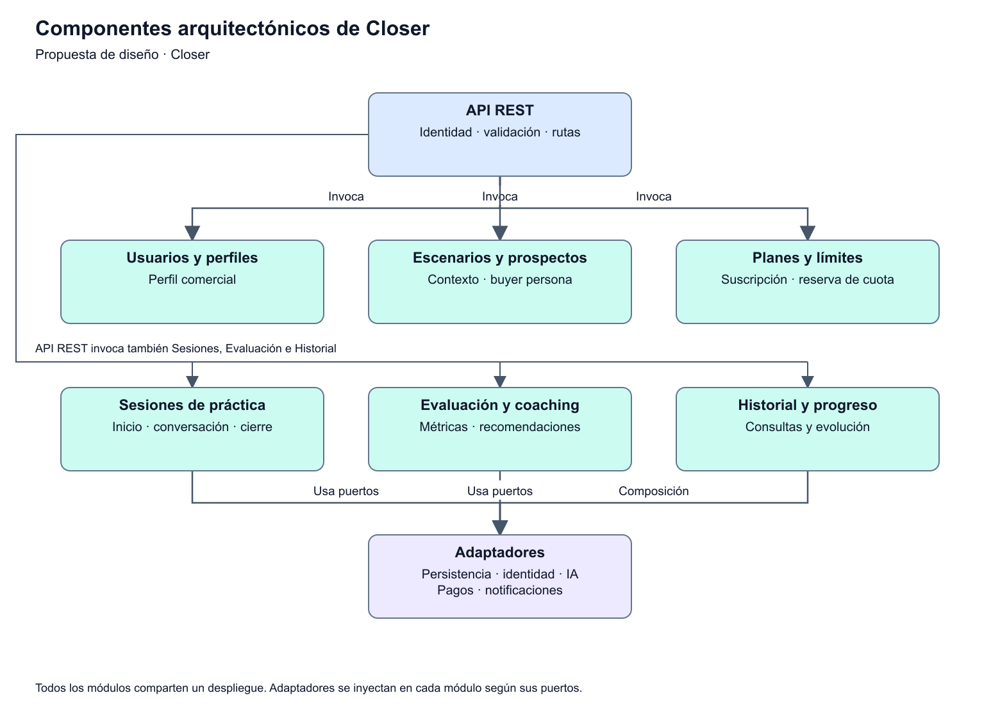

# Componentes arquitectónicos de Closer

El frontend gestiona la interacción; el backend contiene módulos de negocio con Clean Architecture. Las capas internas son separaciones de código, no aplicaciones independientes.

[Fuente SVG editable](../img/fuentes-svg/componentes.svg)

| Componente | Responsabilidad | Requisitos |
|---|---|---|
| Aplicación web | Configurar, capturar y reproducir voz, consultar resultados. | RF01–RF19 |
| Usuarios y perfiles | Perfil comercial y contexto autenticado. | RF01–RF02 |
| Escenarios y prospectos | Producto, prospecto, voz y generación de escenarios. | RF03–RF06, RF15, RF17 |
| Sesiones de práctica | Inicio, autorización, estado, cierre y transcripción. | RF07–RF09, RF14 |
| Evaluación y coaching | Métricas, radar y recomendaciones posteriores. | RF10–RF13 |
| Historial y progreso | Consultar evolución y solicitar eliminación al módulo propietario. | RF16–RF17 |
| Planes y límites | Reservar cuota y consultar suscripción. | RF18 |
| Adaptadores | Persistencia, IA, identidad, pagos y notificaciones; soporte RF19. | RC06–RC10 |

Cada módulo accede a los datos de otro por su API pública. Historial compone consultas; no modifica directamente tablas ajenas. Sesiones obtiene una instantánea del escenario y reserva cuota antes de preparar acceso de voz. Evaluación consume una sesión cerrada; no participa en el streaming.

Ver [C4 nivel 3](../04-modelo-c4/Nivel3-Diagrama-de-Componentes.md) y [diseño interno](../03-diseño-de-software/diseño-interno/diseño-interno-de-modulos.md).
