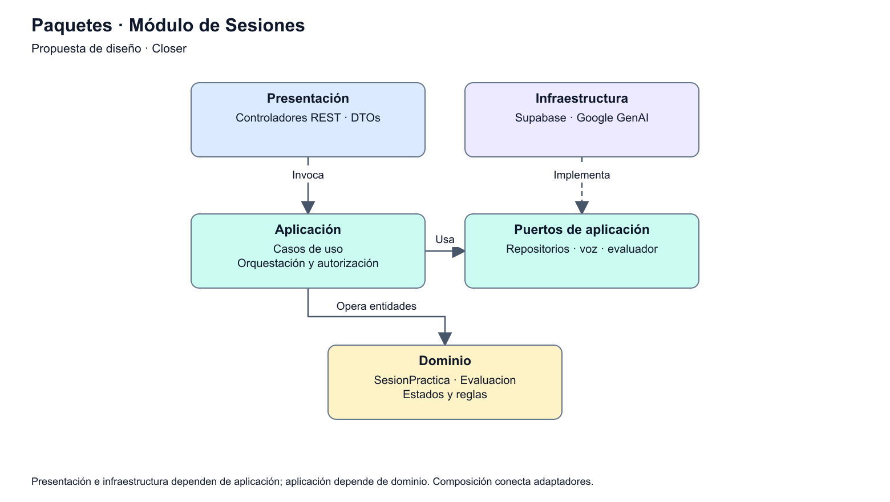
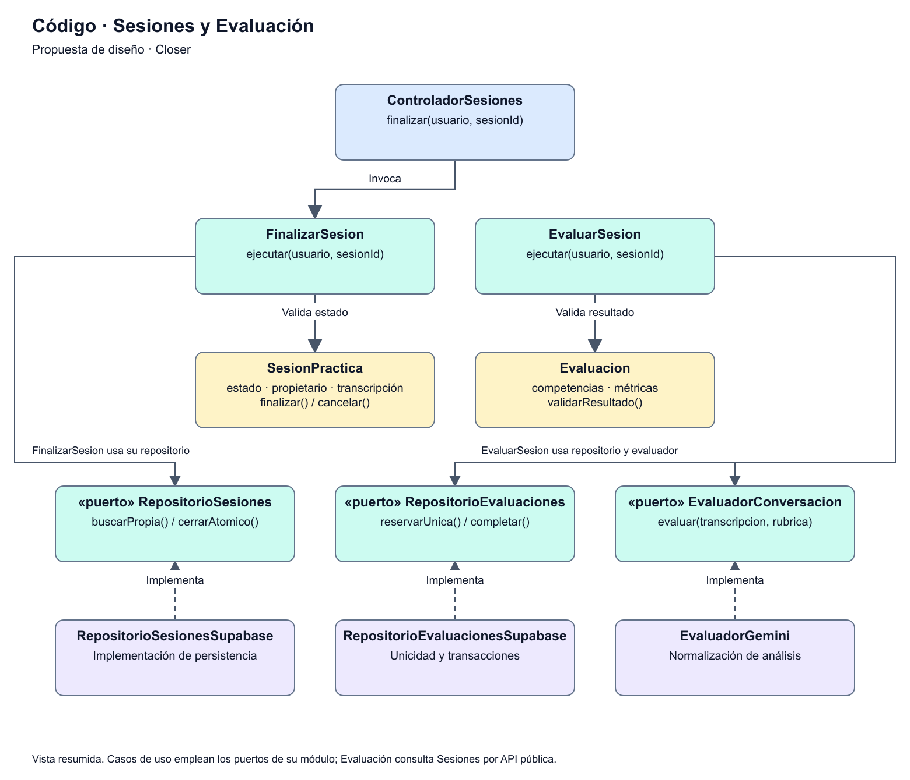
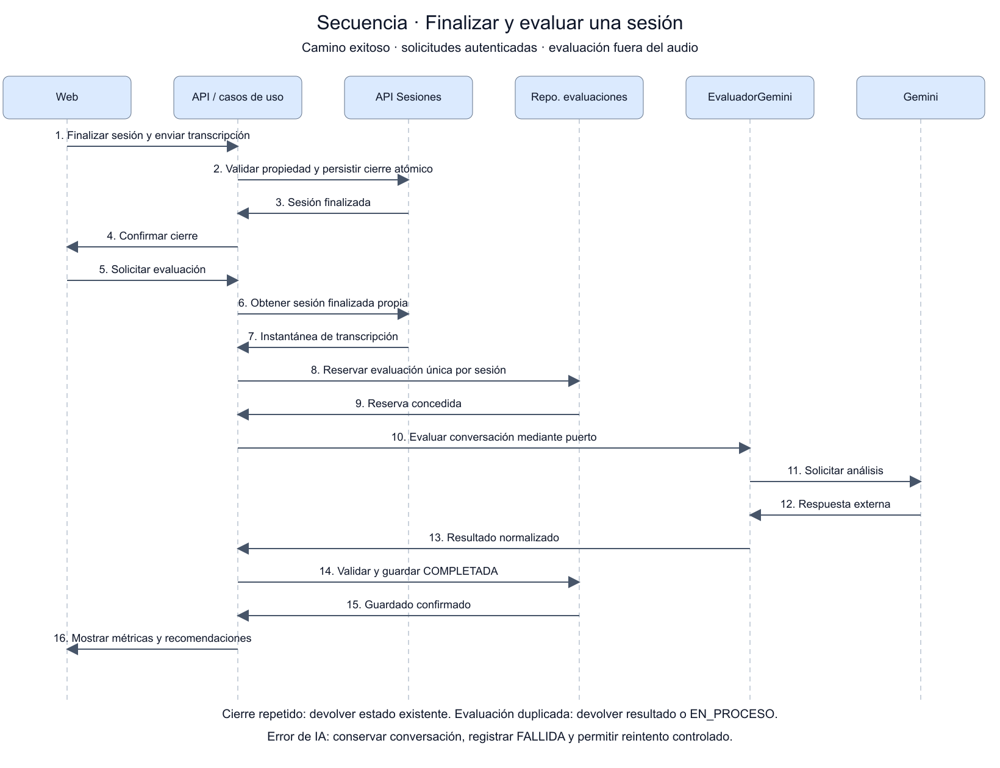

# Diseño interno de módulos

Proyecto: Closer. Módulos de referencia: Sesiones de práctica y Evaluación y coaching. Las secciones siguientes conservan la propuesta del Sprint 1. La sección **[Cómo quedó implementado (Sprint 2)](#cómo-quedó-implementado-sprint-2)** relaciona cada nombre propuesto con el código real.

## Organización propuesta

```text
src/modules/
├── sesiones/
│   ├── dominio/          sesion-practica.ts, estado-sesion.ts
│   ├── aplicacion/       iniciar-simulacion.ts, finalizar-sesion.ts
│   │   └── puertos/      repositorio-sesiones.ts, proveedor-voz.ts
│   ├── infraestructura/ repositorio-sesiones-supabase.ts, adaptador-voz-gemini.ts
│   ├── presentacion/    controlador-sesiones.ts, sesion.dto.ts
│   └── index.ts         API pública y composición del módulo
└── evaluacion/
    ├── dominio/          evaluacion.ts, rubrica.ts
    ├── aplicacion/       evaluar-sesion.ts
    │   └── puertos/      repositorio-evaluaciones.ts, evaluador-conversacion.ts
    ├── infraestructura/ repositorio-evaluaciones-supabase.ts, evaluador-gemini.ts
    ├── presentacion/    controlador-evaluaciones.ts
    └── index.ts
```


[Fuente SVG editable](../../img/fuentes-svg/paquetes-modulo-sesiones.svg)

## Responsabilidades y dependencias

Presentación traduce HTTP y valida formatos; aplicación verifica propiedad y coordina operaciones; dominio valida estados y valores; infraestructura implementa puertos. Los puertos se definen en aplicación, conforme al enfoque ya elegido. Dominio no importa SDK, HTTP ni base de datos; aplicación no importa adaptadores concretos. La composición inyecta adaptadores al iniciar el backend.


[Fuente SVG editable](../../img/fuentes-svg/clases-modulo-sesiones.svg)

| Clase o contrato | Capa | Responsabilidad |
|---|---|---|
| SesionPractica | Dominio | Solo permite PREPARADA → EN_CURSO → FINALIZADA; permite CANCELADA desde PREPARADA o EN_CURSO. |
| Evaluacion | Dominio | Valida competencias, métricas y recomendaciones; separa estado de evaluación del estado de sesión. |
| IniciarSimulacion | Aplicación | Comprueba usuario, escenario y cuota; prepara acceso de voz mediante puertos. |
| FinalizarSesion | Aplicación | Comprueba propietario; guarda transcripción y cierre una sola vez. |
| EvaluarSesion | Aplicación | Solicita sesión cerrada por API pública, reserva evaluación y valida resultados. |
| RepositorioSesiones | Puerto de aplicación | Buscar por propietario, guardar y cerrar con control de concurrencia. |
| RepositorioEvaluaciones | Puerto de aplicación | Reservar por sesión, consultar resultado y actualizar estado. |
| EvaluadorConversacion | Puerto de aplicación | Recibir transcripción y rúbrica; devolver resultado normalizado o error. |

## Secuencia principal


[Fuente SVG editable](../../img/fuentes-svg/secuencia-finalizar-sesion.svg)

1. El navegador detiene audio y solicita cierre con la transcripción registrada.
2. El controlador recibe identidad verificada; FinalizarSesion comprueba propiedad y estado.
3. El repositorio persiste cierre y transcripción de forma atómica. Un cierre repetido devuelve el resultado ya registrado.
4. Una petición posterior solicita evaluación. El módulo obtiene una instantánea de sesión mediante la API pública de Sesiones y verifica que esté finalizada.
5. RepositorioEvaluaciones reserva por sesión con unicidad transaccional: una solicitud gana; las demás reciben el resultado existente o EN_PROCESO.
6. El adaptador invoca IA fuera de la transacción. El dominio valida el resultado y se persiste COMPLETADA; un error deja FALLIDA y permite reintento controlado.

Una reserva vencida debe poder recuperarse después de una caída del proceso. El identificador de sesión y una operación de transición condicional evitan resultados duplicados; no garantizan por sí solos que un proveedor externo cobre una única llamada.

## Casos alternativos

Si preparar voz falla, cancelar la sesión y compensar la reserva de cuota. El consumo definitivo y el tratamiento de interrupciones deben definirse con la política del plan. Si falla IA al evaluar, conservar sesión y transcripción. Si falla persistencia después del análisis, marcar para reconciliación y no informar éxito antes de confirmar el guardado. La política de eliminación debe coordinar Sesiones y Evaluación sin lecturas directas de tablas ajenas.

## Verificación prevista

Probar estados inválidos, acceso ajeno, cierre repetido, solicitudes concurrentes de evaluación, timeout del proveedor y resultados malformados. Usar repositorios en memoria para reglas y pruebas de integración para transacciones y RLS.

## Cómo quedó implementado (Sprint 2)

Decisión durante la implementación: **Sesiones y Evaluación se unieron en un solo módulo `practice`**, porque comparten las mismas entidades (una sesión tiene varios intentos y cada intento se evalúa) y separarlas obligaba a una fachada sin beneficio. Los estados se simplificaron a los de una llamada real: `IN_CALL → EVALUATING → COMPLETED | FAILED`.

```text
apps/api/src/modules/practice/
├── domain/          practice-session.ts, evaluation.ts, scoring.ts, transcript.ts, voice-metrics.ts, prospect-persona.ts
├── application/     start-simulation.use-case.ts, evaluate-simulation.use-case.ts, sessions.use-cases.ts, ai-assist.use-cases.ts
│                    ports.ts  (PracticeRepositoryPort, ConversationAiPort, LiveVoicePort)
├── infrastructure/  prisma-practice.repository.ts, ai/gemini-conversation-ai.adapter.ts, ai/gemini-live-voice.adapter.ts, ai/fake-ai.adapters.ts
├── presentation/    simulations.controller.ts, sessions.controller.ts, assist.controller.ts, practice.dto.ts
└── practice.module.ts   composición: enlaza cada puerto con su adaptador
```

| Propuesto (Sprint 1) | Implementado (Sprint 2) | Comentario |
|---|---|---|
| `SesionPractica` (PREPARADA → EN_CURSO → FINALIZADA) | `PracticeSession` + `Simulation` con `SimulationStatus` ([`practice-session.ts`](../../../apps/api/src/modules/practice/domain/practice-session.ts)) | Una sesión agrupa varios intentos (reintentos) |
| `Evaluacion` | `assembleEvaluation` ([`evaluation.ts`](../../../apps/api/src/modules/practice/domain/evaluation.ts)) y [`scoring.ts`](../../../apps/api/src/modules/practice/domain/scoring.ts) | Valida la respuesta de la IA; el puntaje lo calcula el servidor |
| `IniciarSimulacion` | `StartSimulationUseCase` ([`start-simulation.use-case.ts`](../../../apps/api/src/modules/practice/application/start-simulation.use-case.ts)) | Crea la sesión y el intento y emite el token efímero de voz |
| `FinalizarSesion` + `EvaluarSesion` | `EvaluateSimulationUseCase` ([`evaluate-simulation.use-case.ts`](../../../apps/api/src/modules/practice/application/evaluate-simulation.use-case.ts)) | Cerrar y evaluar es una sola operación idempotente |
| `RepositorioSesiones` / `RepositorioEvaluaciones` | `PracticeRepositoryPort` → `PrismaPracticeRepository` | Un solo repositorio para el agregado sesión–intentos |
| `EvaluadorConversacion` → `EvaluadorGemini` | `ConversationAiPort` → `GeminiConversationAiAdapter` | Suma operaciones: extracción de perfil, coach y escenarios |
| `ProveedorVoz` → `AdaptadorVozGemini` | `LiveVoicePort` → `GeminiLiveVoiceAdapter` | Token efímero con prompt y modelo bloqueados (ADR-007) |
| `repositorio-*-supabase.ts` | Prisma sobre el PostgreSQL de Supabase | Supabase se usa como PostgreSQL administrado y para Auth |

Los demás módulos siguen la misma estructura: `identity` (token y onboarding), `profiles` (biblioteca de prospectos), `support` (contacto) y `health` (salud y métricas), más `shared` (caché, límites de uso, errores y configuración).
