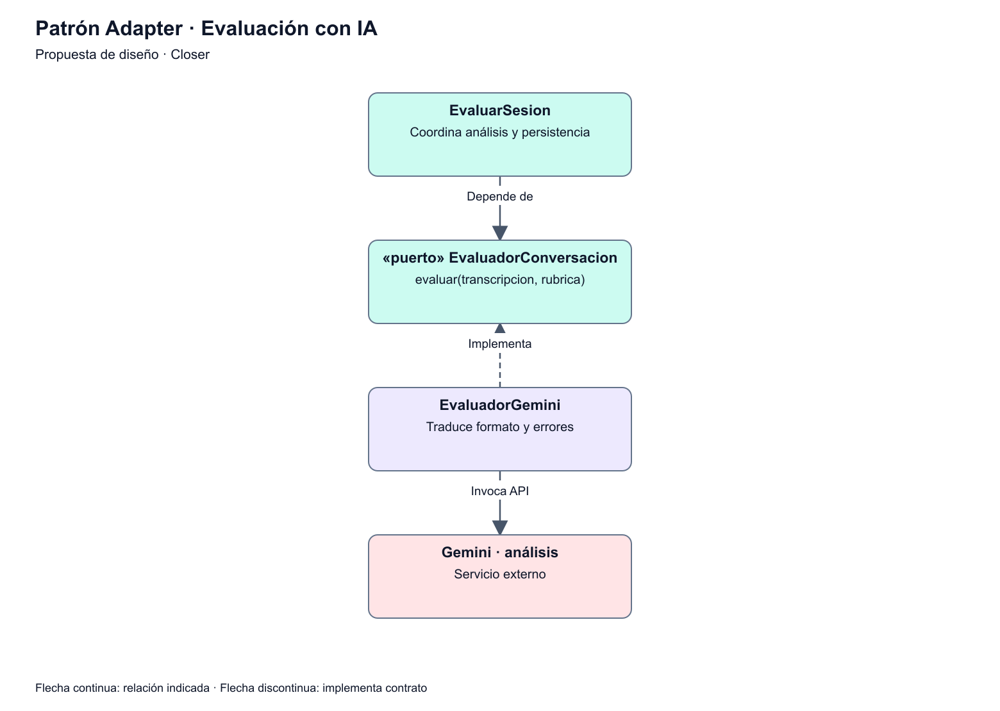
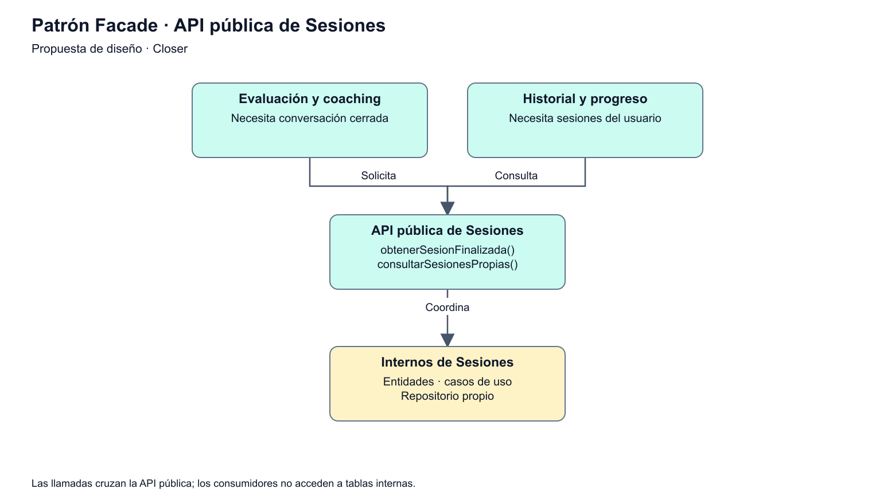
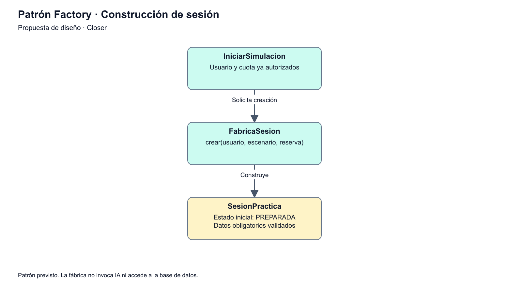
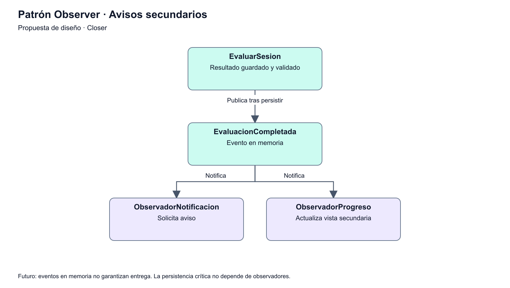

# Patrones de diseño de Closer

La tabla siguiente es el diseño propuesto en el Sprint 1. La sección **[Patrones en el código (Sprint 2)](#patrones-en-el-código-sprint-2)** indica cuáles se implementaron, dónde, y qué patrones adicionales surgieron al construir el sistema.

| Patrón | Uso propuesto | Problema resuelto | Estado |
|---|---|---|---|
| Adapter | EvaluadorGemini y AdaptadorVozGemini implementan puertos de aplicación. | Traducir formatos y errores externos sin acoplar casos de uso. | Base del diseño |
| Repository | Repositorios de sesiones y evaluaciones. | Encapsular persistencia y operaciones transaccionales. | Base del diseño |
| Facade | API pública de Sesiones, utilizada por Evaluación e Historial. | Exponer operaciones estables sin acceder a entidades internas o tablas. | Base del diseño |
| Strategy | Rúbricas de prospección, descubrimiento y cierre. | Variar criterios sin condicionales dispersos. | Previsto si las rúbricas requieren lógica distinta |
| Factory | Creación validada de SesionPractica. | Centralizar estado inicial y datos obligatorios. | Previsto si la construcción crece |
| Observer | Reacción a EvaluacionCompletada para notificación. | Separar acciones secundarias de la evaluación. | Futuro; no usado para persistencia crítica |

## Adapter y Repository

[Fuente SVG editable](../../img/fuentes-svg/patron-adapter.svg)

EvaluarSesion recibe EvaluadorConversacion por inyección. EvaluadorGemini traduce una respuesta externa al resultado del contrato; valida formato y normaliza errores. RepositorioEvaluaciones encapsula unicidad, reserva y actualización de estados. Cambiar un proveedor exige comprobar que siga respetando el contrato.

## Facade

[Fuente SVG editable](../../img/fuentes-svg/patron-facade.svg)

La API pública de Sesiones ofrece obtenerSesionFinalizada(usuario, id). Comprueba acceso y devuelve una instantánea estable; Evaluación no consulta directamente las tablas de Sesiones.

## Strategy

[Fuente SVG editable](../../img/fuentes-svg/patron-strategy.svg)

Una EstrategiaRubrica devuelve criterios según etapa comercial. Sus implementaciones deben respetar formato y escala comunes; el caso de uso recibe la estrategia seleccionada. Si solo cambian datos, basta una configuración de rúbrica sin nuevas clases.

## Factory

[Fuente SVG editable](../../img/fuentes-svg/patron-factory.svg)

FabricaSesion construye una entidad PREPARADA a partir de usuario, escenario y referencia de reserva de cuota ya autorizados. No llama a IA ni accede a persistencia. El caso de uso conserva la orquestación.

## Observer

[Fuente SVG editable](../../img/fuentes-svg/patron-observer.svg)

Un evento de evaluación completada puede activar notificaciones secundarias. Un evento en memoria se pierde si el proceso cae; si se requiere entrega garantizada, evaluar posteriormente persistencia de eventos y reintentos. La evaluación se guarda antes de publicar; el fallo de notificación no invalida el resultado.

## Patrones en el código (Sprint 2)

### Patrones propuestos y su estado

| Patrón | Estado | Dónde |
|---|---|---|
| Adapter | ✅ Implementado | [`gemini-conversation-ai.adapter.ts`](../../../apps/api/src/modules/practice/infrastructure/ai/gemini-conversation-ai.adapter.ts) y [`gemini-live-voice.adapter.ts`](../../../apps/api/src/modules/practice/infrastructure/ai/gemini-live-voice.adapter.ts) traducen Gemini a los puertos; [`redis-cache.adapter.ts`](../../../apps/api/src/shared/infrastructure/cache/redis-cache.adapter.ts) y [`redis-rate-limiter.adapter.ts`](../../../apps/api/src/shared/infrastructure/rate-limit/redis-rate-limiter.adapter.ts) hacen lo mismo con Redis; [`supabase-jwt.verifier.ts`](../../../apps/api/src/modules/identity/infrastructure/supabase-jwt.verifier.ts) con Supabase Auth. |
| Repository | ✅ Implementado | [`prisma-practice.repository.ts`](../../../apps/api/src/modules/practice/infrastructure/prisma-practice.repository.ts), [`prisma-profile.repository.ts`](../../../apps/api/src/modules/profiles/infrastructure/prisma-profile.repository.ts) y [`prisma-user.repository.ts`](../../../apps/api/src/modules/identity/infrastructure/prisma-user.repository.ts). Encapsulan Prisma y las operaciones atómicas (reserva de evaluación, transacción en lote). |
| Facade | ➖ No necesario | Sesiones y Evaluación se unieron en el módulo `practice`, así que ningún otro módulo consulta sus tablas. |
| Strategy | 🔄 Aplicado al proveedor de IA | La estrategia de IA (Gemini o simulada) se elige por configuración en [`practice.module.ts`](../../../apps/api/src/modules/practice/practice.module.ts). Las rúbricas por etapa no necesitaron clases: los modos y tonos son datos en [`prospect-persona.ts`](../../../apps/api/src/modules/practice/domain/prospect-persona.ts). |
| Factory | ✅ Implementado (composición) | Los `useFactory` de Nest crean el adaptador según `AI_PROVIDER`; `provisionalSessionName` y [`session-title.ts`](../../../apps/api/src/modules/practice/domain/session-title.ts) construyen valores iniciales válidos. |
| Observer | ⏳ Futuro | No se necesitó: la evaluación invalida la caché directamente después de guardar. |

### Patrones que surgieron en la implementación

| Patrón | Problema que resuelve | Dónde |
|---|---|---|
| **Cache-aside** | Lecturas repetidas de onboarding, biblioteca e historial sin tocar PostgreSQL | `getOrSet` en [`redis-cache.adapter.ts`](../../../apps/api/src/shared/infrastructure/cache/redis-cache.adapter.ts); invalidación en cada escritura ([análisis](../../arquitectura/analisis-bd-cache.md)) |
| **Máquina de estados + compare-and-set** | Evaluación idempotente: dos peticiones simultáneas no evalúan dos veces (ADR-006) | `decideEvaluation` en [`practice-session.ts`](../../../apps/api/src/modules/practice/domain/practice-session.ts) y `claimForEvaluation` (UPDATE condicional) en el repositorio |
| **Decorator + Guard** | Límites de uso declarativos por endpoint | `@RateLimit(...)` y `RateLimitGuard` en [`rate-limit.guard.ts`](../../../apps/api/src/shared/presentation/rate-limit.guard.ts) |
| **Traductor de excepciones** | El dominio lanza errores propios y un solo filtro los convierte en respuestas HTTP | [`errors.ts`](../../../apps/api/src/shared/domain/errors.ts) → [`domain-exception.filter.ts`](../../../apps/api/src/shared/presentation/domain-exception.filter.ts) |
| **Test doubles (Fake/Stub)** | Probar casos de uso sin red ni base de datos | [`fakes.ts`](../../../apps/api/src/test-support/fakes.ts) y [`fake-ai.adapters.ts`](../../../apps/api/src/modules/practice/infrastructure/ai/fake-ai.adapters.ts) |
| **Degradación controlada (fail-open)** | Si Redis cae, la app sigue funcionando contra PostgreSQL | `try/catch` en los adaptadores de caché y de rate limit |
