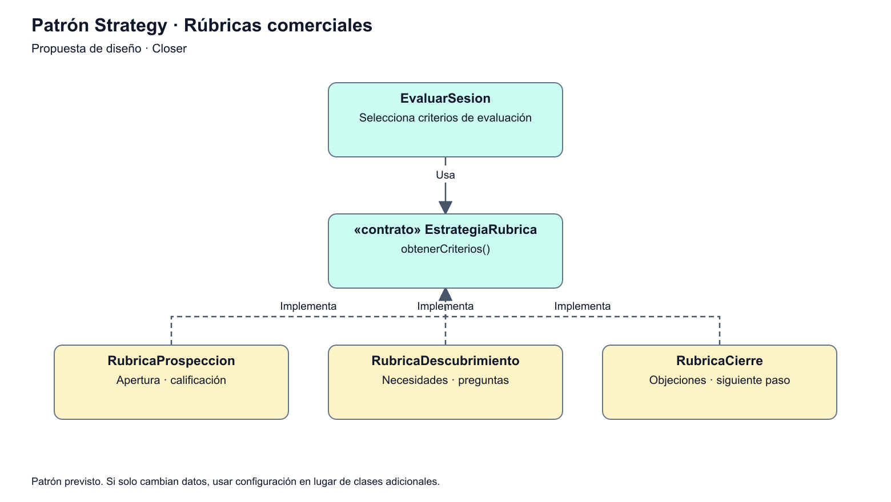

# Patrones de diseño de Closer

Estos patrones describen el diseño propuesto; no implican que exista una implementación. Se distinguen los necesarios para la arquitectura actual de las alternativas para futuras iteraciones.

| Patrón | Uso propuesto | Problema resuelto | Estado |
|---|---|---|---|
| Adapter | EvaluadorGemini y AdaptadorVozGemini implementan puertos de aplicación. | Traducir formatos y errores externos sin acoplar casos de uso. | Base del diseño |
| Repository | Repositorios de sesiones y evaluaciones. | Encapsular persistencia y operaciones transaccionales. | Base del diseño |
| Facade | API pública de Sesiones, utilizada por Evaluación e Historial. | Exponer operaciones estables sin acceder a entidades internas o tablas. | Base del diseño |
| Strategy | Rúbricas de prospección, descubrimiento y cierre. | Variar criterios sin condicionales dispersos. | Previsto si las rúbricas requieren lógica distinta |
| Factory | Creación validada de SesionPractica. | Centralizar estado inicial y datos obligatorios. | Previsto si la construcción crece |
| Observer | Reacción a EvaluacionCompletada para notificación. | Separar acciones secundarias de la evaluación. | Futuro; no usado para persistencia crítica |

## Adapter y Repository

[Fuente SVG editable](../../img/fuentes-svg/patron-adapter.svg)

EvaluarSesion recibe EvaluadorConversacion por inyección. EvaluadorGemini traduce una respuesta externa al resultado del contrato; valida formato y normaliza errores. RepositorioEvaluaciones encapsula unicidad, reserva y actualización de estados. Cambiar un proveedor exige comprobar que siga respetando el contrato.

## Facade

[Fuente SVG editable](../../img/fuentes-svg/patron-facade.svg)

La API pública de Sesiones ofrece obtenerSesionFinalizada(usuario, id). Comprueba acceso y devuelve una instantánea estable; Evaluación no consulta directamente las tablas de Sesiones.

## Strategy

[Fuente SVG editable](../../img/fuentes-svg/patron-strategy.svg)

Una EstrategiaRubrica devuelve criterios según etapa comercial. Sus implementaciones deben respetar formato y escala comunes; el caso de uso recibe la estrategia seleccionada. Si solo cambian datos, basta una configuración de rúbrica sin nuevas clases.

## Factory

[Fuente SVG editable](../../img/fuentes-svg/patron-factory.svg)

FabricaSesion construye una entidad PREPARADA a partir de usuario, escenario y referencia de reserva de cuota ya autorizados. No llama a IA ni accede a persistencia. El caso de uso conserva la orquestación.

## Observer

[Fuente SVG editable](../../img/fuentes-svg/patron-observer.svg)

Un evento de evaluación completada puede activar notificaciones secundarias. Un evento en memoria se pierde si el proceso cae; si se requiere entrega garantizada, evaluar posteriormente persistencia de eventos y reintentos. La evaluación se guarda antes de publicar; el fallo de notificación no invalida el resultado.
