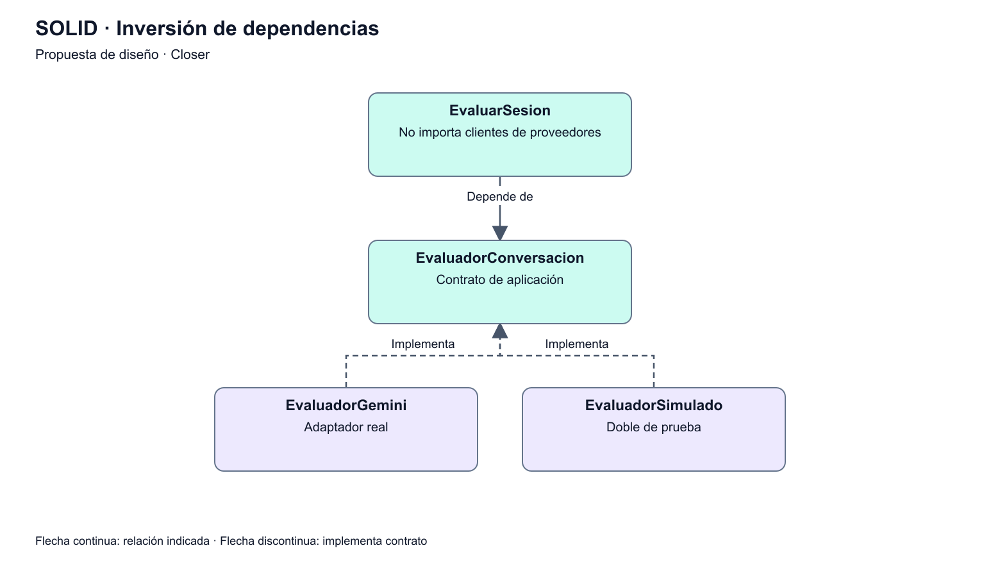

# Principios de diseño de Closer

SOLID guía la separación de responsabilidades del backend modular. Las secciones iniciales conservan el diseño del Sprint 1; la sección **[SOLID en el código (Sprint 2)](#solid-en-el-código-sprint-2)** muestra dónde quedó aplicado cada principio en la implementación real.

[Fuente SVG editable](../../img/fuentes-svg/solid-modulo-sesiones.svg)

| Principio | Aplicación concreta | Cómo revisarlo |
|---|---|---|
| S — Responsabilidad única | Controlador traduce HTTP; caso de uso coordina; entidad valida; adaptador integra. | Una modificación en el formato de IA no cambia la entidad SesionPractica. |
| O — Abierto/cerrado | Incorporar un evaluador compatible implementando el puerto. | Cambiar composición sin añadir condiciones por proveedor al caso de uso. |
| L — Sustitución de Liskov | Evaluador simulado y real mantienen contrato, errores y escala de resultado. | Pruebas comunes de contrato para éxito, timeout y respuesta inválida. |
| I — Segregación de interfaces | ProveedorVoz y EvaluadorConversacion son contratos distintos. | No obligar al evaluador a implementar operaciones de streaming. |
| D — Inversión de dependencias | EvaluarSesion depende de puertos; infraestructura los implementa. | Dominio y aplicación no importan Google GenAI ni clientes de Supabase. |

## Inversión de dependencias

[Fuente SVG editable](../../img/fuentes-svg/principio-dip.svg)

Las flechas de dependencia de código apuntan hacia contratos y entidades. La llamada en ejecución puede ir del caso de uso al adaptador, aunque la dependencia de código del adaptador apunta al contrato. La composición es el lugar donde se conocen las implementaciones concretas.

## Otros criterios

Validar datos en la frontera y reglas en dominio. No introducir interfaces sin necesidad de sustitución o prueba. Aplicar autorización antes de llamadas externas; no confiar solo en la interfaz web. Concentrar transiciones de estado y hacer idempotentes cierre y evaluación. Registrar identificadores y errores operativos sin incluir secretos ni transcripciones completas en logs generales.

## SOLID en el código (Sprint 2)

En la implementación, Sesiones y Evaluación quedaron en un solo módulo `practice` (ver [diseño interno](diseño-interno-de-modulos.md#cómo-quedó-implementado-sprint-2)). Los principios se aplican así:

| Principio | Dónde está en el código | Evidencia verificable |
|---|---|---|
| **S** — Responsabilidad única | [`simulations.controller.ts`](../../../apps/api/src/modules/practice/presentation/simulations.controller.ts) solo traduce HTTP; [`evaluate-simulation.use-case.ts`](../../../apps/api/src/modules/practice/application/evaluate-simulation.use-case.ts) coordina; [`scoring.ts`](../../../apps/api/src/modules/practice/domain/scoring.ts) calcula el puntaje; [`gemini-conversation-ai.adapter.ts`](../../../apps/api/src/modules/practice/infrastructure/ai/gemini-conversation-ai.adapter.ts) habla con Gemini. | Cuando Google retiró `gemini-2.5-flash-lite` solo cambió la configuración del adaptador: ni el caso de uso ni el dominio se tocaron. |
| **O** — Abierto/cerrado | Nuevos proveedores de IA se agregan implementando `ConversationAiPort` y `LiveVoicePort` ([`ports.ts`](../../../apps/api/src/modules/practice/application/ports.ts)). La elección está en [`practice.module.ts`](../../../apps/api/src/modules/practice/practice.module.ts) (`AI_PROVIDER`). | Existen dos implementaciones (Gemini y simulada) sin ningún `if` de proveedor en los casos de uso. |
| **L** — Sustitución de Liskov | [`fake-ai.adapters.ts`](../../../apps/api/src/modules/practice/infrastructure/ai/fake-ai.adapters.ts) y [`fakes.ts`](../../../apps/api/src/test-support/fakes.ts) (`InMemoryPracticeRepository`, `InMemoryCache`, `StubConversationAi`) cumplen los mismos contratos que los adaptadores reales. | Las pruebas unitarias corren con los dobles y las de integración con PostgreSQL y Redis reales; los mismos casos de uso pasan en ambos. Las pruebas de carga usan el adaptador simulado. |
| **I** — Segregación de interfaces | Puertos pequeños y separados: `ConversationAiPort` (texto) y `LiveVoicePort` (voz) en `practice`; `CachePort` y `RateLimiterPort` en `shared/application/ports`; `SupportRepositoryPort` y `SupportNotifierPort` en `support`. | El adaptador de voz no implementa evaluación y el de caché no sabe de límites de uso. |
| **D** — Inversión de dependencias | Los casos de uso reciben puertos por inyección (`@Inject(CONVERSATION_AI)`, `@Inject(PRACTICE_REPOSITORY)`, `@Inject(CACHE)`); cada módulo de Nest enlaza el puerto con su adaptador. | **Lo comprueba ESLint** ([`eslint.config.mjs`](../../../apps/api/eslint.config.mjs)): el dominio no puede importar Nest, Prisma, Redis ni Google GenAI, y la aplicación no puede importar infraestructura ni presentación. El CI falla si alguien rompe la regla. |
