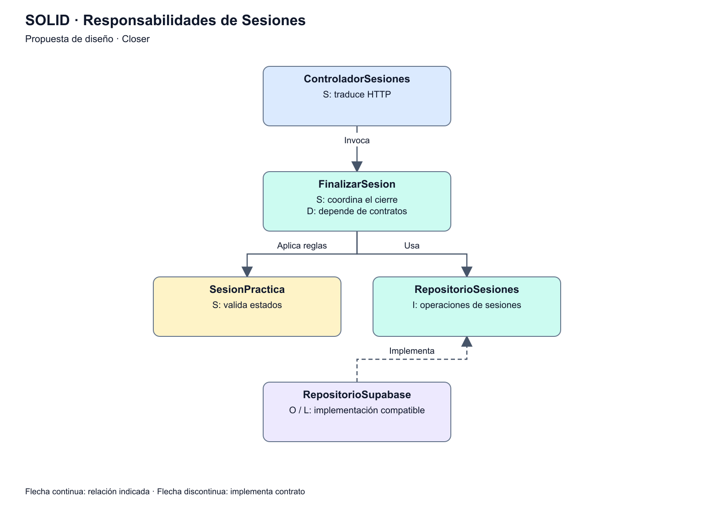

# Principios de diseño de Closer

SOLID guía la separación de responsabilidades del backend modular. Se aplica a Sesiones y Evaluación, conservando los puertos en la capa de aplicación.

[Fuente SVG editable](../../img/fuentes-svg/solid-modulo-sesiones.svg)

| Principio | Aplicación concreta | Cómo revisarlo |
|---|---|---|
| S — Responsabilidad única | Controlador traduce HTTP; caso de uso coordina; entidad valida; adaptador integra. | Una modificación en el formato de IA no cambia la entidad SesionPractica. |
| O — Abierto/cerrado | Incorporar un evaluador compatible implementando el puerto. | Cambiar composición sin añadir condiciones por proveedor al caso de uso. |
| L — Sustitución de Liskov | Evaluador simulado y real mantienen contrato, errores y escala de resultado. | Pruebas comunes de contrato para éxito, timeout y respuesta inválida. |
| I — Segregación de interfaces | ProveedorVoz y EvaluadorConversacion son contratos distintos. | No obligar al evaluador a implementar operaciones de streaming. |
| D — Inversión de dependencias | EvaluarSesion depende de puertos; infraestructura los implementa. | Dominio y aplicación no importan Google GenAI ni clientes de Supabase. |

## Inversión de dependencias

[Fuente SVG editable](../../img/fuentes-svg/principio-dip.svg)

Las flechas de dependencia de código apuntan hacia contratos y entidades. La llamada en ejecución puede ir del caso de uso al adaptador, aunque la dependencia de código del adaptador apunta al contrato. La composición es el lugar donde se conocen las implementaciones concretas.

## Otros criterios

Validar datos en la frontera y reglas en dominio. No introducir interfaces sin necesidad de sustitución o prueba. Aplicar autorización antes de llamadas externas; no confiar solo en la interfaz web. Concentrar transiciones de estado y hacer idempotentes cierre y evaluación. Registrar identificadores y errores operativos sin incluir secretos ni transcripciones completas en logs generales.
