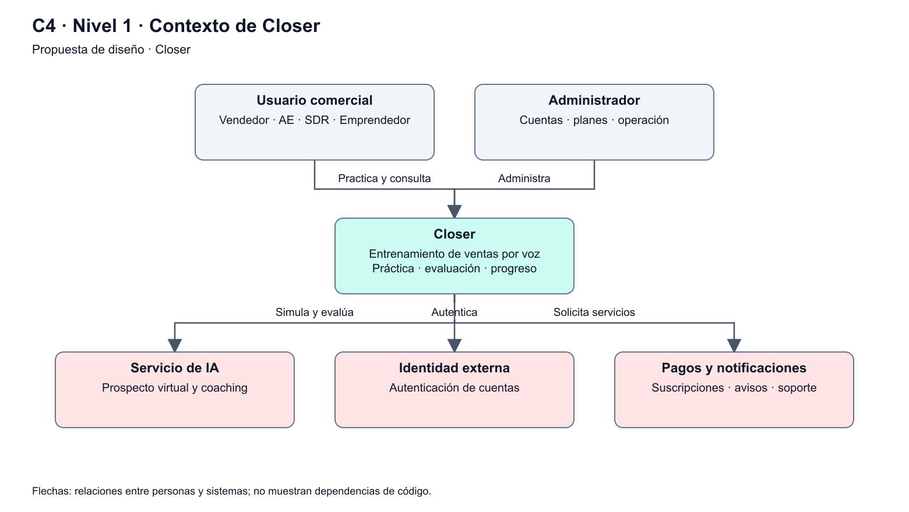

# Nivel 1 · Contexto del sistema

Proyecto: Closer. Vista de personas y sistemas externos, dirigida a docente, negocio y equipo. Closer aparece como una sola caja; sus módulos y tecnologías internas se detallan en niveles posteriores.

[Fuente SVG editable](../img/fuentes-svg/nivel1-contexto.svg)

| Persona o sistema | Responsabilidad | Relación con Closer |
|---|---|---|
| Usuario comercial | Vendedor, AE, SDR o emprendedor. | Configura prácticas, conversa y revisa resultados. |
| Administrador | Supervisa cuentas, planes y operación. | Administra la plataforma. |
| Servicio de IA | Simula prospectos, genera escenarios y evalúa conversaciones. | Recibe contexto autorizado y devuelve voz o análisis. |
| Identidad externa | Autentica cuentas y permite OAuth. | Proporciona identidad verificable. |
| Pasarela de pagos | Procesa suscripciones. | Intercambia referencias y estados de pago. |
| Notificaciones | Entrega avisos y solicitudes de soporte. | Recibe mensajes autorizados. |

La base de datos forma parte de la solución y no se representa como otro producto de negocio en esta vista. Se detallan servicios administrados en nivel 2. Las transcripciones pertenecen a cada usuario y las credenciales permanentes de los proveedores permanecen en servidor. Los proveedores concretos de pagos y notificaciones están pendientes de selección.

[Siguiente: contenedores](Nivel2-DiagramadeContenedores.md).
