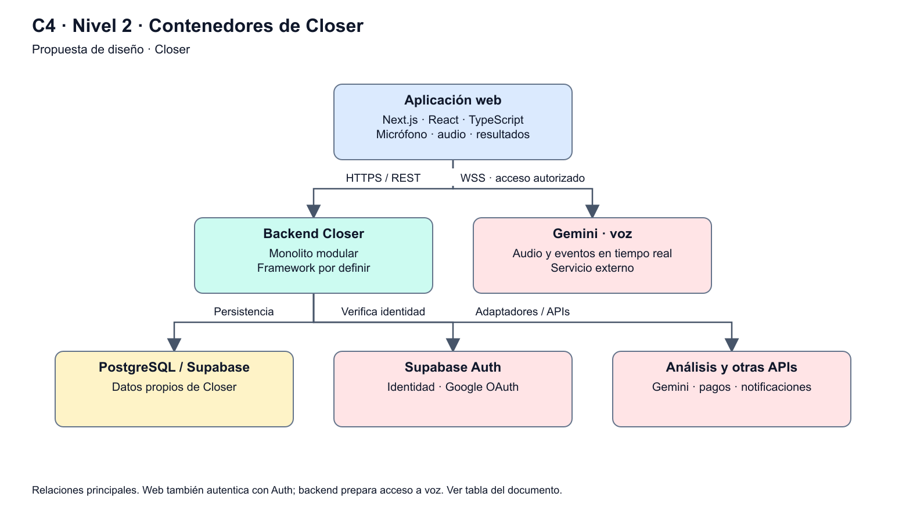
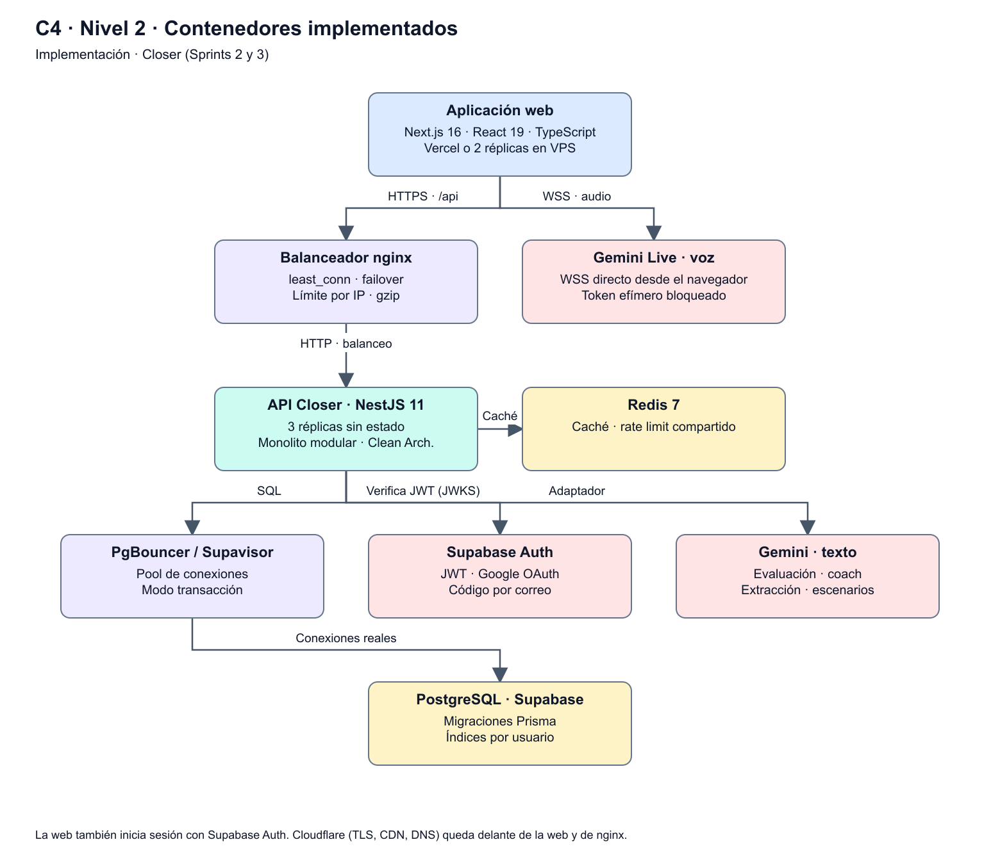

# Nivel 2 · Contenedores

Un contenedor C4 es una aplicación o almacén ejecutable; no implica Docker. La frontera de Closer comprende interfaz, backend y datos propios alojados en servicios administrados.

[Fuente SVG editable](../img/fuentes-svg/nivel2-contenedores.svg)

| Elemento | Tecnología propuesta o restricción | Responsabilidad |
|---|---|---|
| Aplicación web | Next.js, React y TypeScript | Interfaz, micrófono, audio y consulta de resultados. |
| Backend Closer | Monolito modular; framework por definir | Casos de uso, autorización, cuotas e integraciones. |
| Almacén de datos | PostgreSQL administrado por Supabase | Perfiles, escenarios, sesiones, transcripciones y evaluaciones. |
| Identidad administrada | Supabase Auth (enlace mágico por correo) | Autenticación; servicio externo al código del backend. |
| IA de voz y análisis | Gemini mediante integración Google GenAI | Capacidades externas; no son microservicios propios. |

| Origen → destino | Comunicación y propósito |
|---|---|
| Web → backend | HTTPS/REST, contexto autenticado, gestión de prácticas. |
| Web ↔ Auth | HTTPS para autenticación. |
| Web ↔ IA de voz | WSS para audio y eventos, condicionado al mecanismo de acceso autorizado. |
| Backend → IA | Preparación de acceso de voz y análisis posterior mediante adaptadores. |
| Backend → PostgreSQL | Persistencia mediante adaptadores Supabase; transporte cifrado según cliente elegido. |
| Backend → Auth | Verificar identidad; no confiar en el identificador enviado por el navegador. |
| Backend → pagos/notificaciones | APIs externas, secretos solo en servidor. |

El esquema conserva una separación lógica entre Next.js y backend; no fija un proveedor de alojamiento ni un framework de backend. Storage queda fuera del flujo obligatorio y se incorporará si se requieren archivos. No hay caché ni broker en esta propuesta. Validar el acceso temporal al canal de voz antes de implementar; si no cumple las restricciones, revisar el diseño del transporte. Medir escalabilidad y disponibilidad por contenedor y por dependencia externa.

## Implementación (Sprints 2 y 3)

La propuesta anterior se conserva como diseño del Sprint 1. Así quedaron los contenedores al implementarla:

[Fuente SVG editable](../img/fuentes-svg/nivel2-contenedores-implementado.svg)

| Contenedor | Tecnología | Responsabilidad | Escala |
|---|---|---|---|
| Aplicación web | Next.js 16, React 19, TypeScript, Zustand | Interfaz, micrófono, audio, resultados | Vercel (CDN) o 2 réplicas *standalone* |
| Balanceador | nginx 1.27 | Reparto `least_conn`, *failover*, límite por IP, gzip | 1 por servidor; Cloudflare delante |
| API Closer | NestJS 11, Prisma 6, imagen Docker | Casos de uso, autorización, evaluación, integraciones | 3 réplicas sin estado |
| Redis | Redis 7 | Caché y rate limit compartidos | 1 (Upstash en la opción administrada) |
| Pool de conexiones | PgBouncer (local) o Supavisor (Supabase) | Multiplexar conexiones hacia PostgreSQL | — |
| PostgreSQL | Supabase | Usuarios, onboarding, prospectos, sesiones, simulaciones, soporte | Administrado |
| Supabase Auth | Servicio externo | Enlace mágico por correo (PKCE); emite el JWT | Administrado |
| Gemini | Servicio externo | Voz en vivo (WSS) y texto: evaluación, coach, extracción | Cuotas del proveedor |

| Origen → destino | Comunicación |
|---|---|
| Web → nginx → API | HTTPS/REST en `/api/v1` con `Authorization: Bearer` (mismo dominio que la web) |
| Web ↔ Gemini Live | WSS con token efímero de un solo uso emitido por la API |
| API → Supabase Auth | Verificación local del JWT (HS256 o JWKS), sin llamada por petición |
| API → PgBouncer/Supavisor → PostgreSQL | SQL mediante Prisma; pool acotado por réplica |
| API → Redis | Caché *cache-aside* y contadores de límites |
| API → Gemini | Adaptadores con salida JSON estructurada y reintentos |

Despliegue y escalabilidad: [ADR-009](../arquitectura/ADR-009-escalabilidad.md) y [CI/CD](../despliegue/ci-cd.md).

[Anterior: contexto](Nivel1-DiagramadeContextodelSistema.md) · [Siguiente: componentes](Nivel3-Diagrama-de-Componentes.md).
