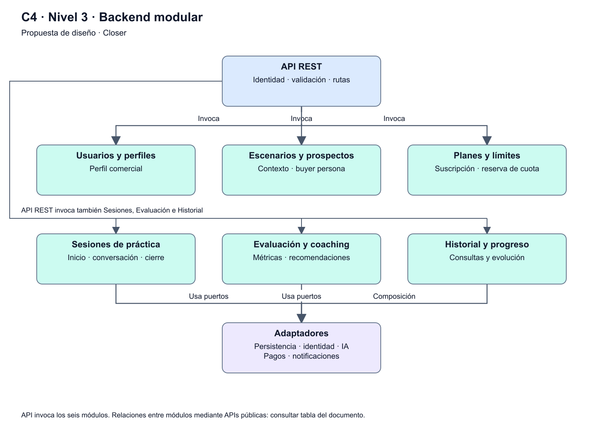
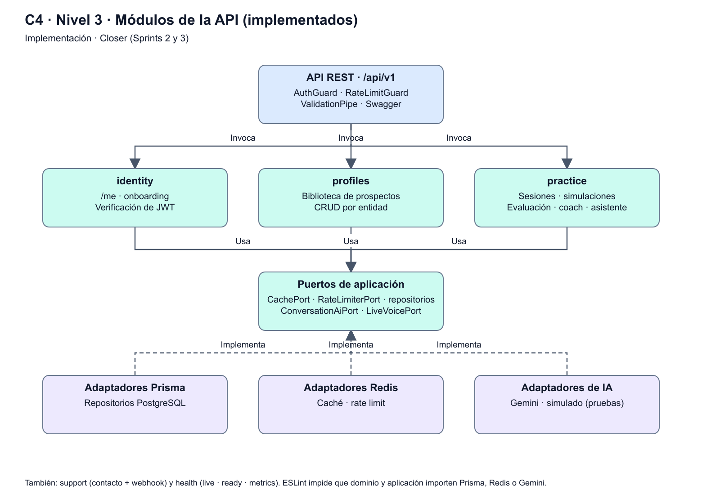

# Nivel 3 · Componentes del backend Closer

Esta vista abre el contenedor Backend Closer. Todos los módulos se despliegan juntos y se comunican en memoria por APIs públicas; no son microservicios.

[Fuente SVG editable](../img/fuentes-svg/nivel3-componentes.svg)

| Componente | Operaciones principales | Dependencias autorizadas |
|---|---|---|
| API REST | Validar formato, autenticar y enrutar. | APIs públicas de módulos. |
| Usuarios y perfiles | Consultar perfil y contexto de cuenta. | Adaptador de identidad y repositorio propio. |
| Escenarios y prospectos | Crear, generar y reutilizar escenarios. | Adaptador de análisis y repositorio propio. |
| Sesiones de práctica | Iniciar, registrar conversación y finalizar. | Usuarios, Escenarios y Planes mediante APIs públicas; proveedor de voz. |
| Evaluación y coaching | Evaluar sesión cerrada y consultar resultado. | API pública de Sesiones, evaluador y repositorio propio. |
| Historial y progreso | Componer sesiones y resultados del usuario. | APIs de Sesiones y Evaluación. |
| Planes y límites | Consultar plan, reservar y compensar cuota. | Repositorio propio y adaptador de pagos. |

## Reglas de colaboración

Cada módulo controla sus tablas. Historial solicita a Sesiones la eliminación de una sesión; Sesiones coordina la eliminación de resultados mediante la API de Evaluación. Definir atomicidad o reconciliación antes de implementar la eliminación compuesta. El soporte RF19 usa un caso de uso con adaptador de notificaciones. Los adaptadores se componen por módulo y pueden compartir utilidades técnicas sin compartir reglas de negocio.

Las rutas propuestas incluyen POST /sesiones, POST /sesiones/{id}/finalizar, POST /sesiones/{id}/evaluacion y GET /historial. No constituyen un contrato implementado. Autenticación, propiedad y cuota se verifican antes de invocar IA.

## Implementación (Sprints 2 y 3)

[Fuente SVG editable](../img/fuentes-svg/nivel3-componentes-implementado.svg)

Correspondencia entre los módulos propuestos y los implementados (`apps/api/src/modules`):

| Propuesta (Sprint 1) | Implementación | Endpoints |
|---|---|---|
| Usuarios y perfiles | `identity` | `GET /me`, `GET/PUT /me/onboarding`, `POST /auth/dev-token` (solo desarrollo) |
| Escenarios y prospectos | `profiles` + asistente de `practice` | `GET/POST /profiles`, `PATCH/DELETE /profiles/:id`, `POST /assist/extract-profile`, `POST /assist/scenario` |
| Sesiones de práctica | `practice` | `POST /simulations` (inicia, emite token de voz), `POST /simulations/:id/coach` |
| Evaluación y coaching | `practice` | `POST /simulations/:id/evaluate` (idempotente) |
| Historial y progreso | `practice` | `GET /sessions`, `GET/PATCH/DELETE /sessions/:id` |
| Planes y límites | Congelado; límites de uso con rate limiting | — |
| Soporte (RF19) | `support` | `POST /support/contacts` |
| — | `health` | `GET /health/live`, `/ready`, `/metrics` |

Sesiones, evaluación e historial quedaron en un solo módulo (`practice`) porque comparten las mismas tablas (`practice_sessions`, `simulations`) y el mismo ciclo de vida; separarlos obligaba a exponer APIs internas sin beneficio. El contrato completo está en Swagger (`/api/docs`) y en las [especificaciones SDD](../specs/README.md).

[Anterior: contenedores](Nivel2-DiagramadeContenedores.md) · [Siguiente: código](Nivel4-DiagramadeCodigo.md).
