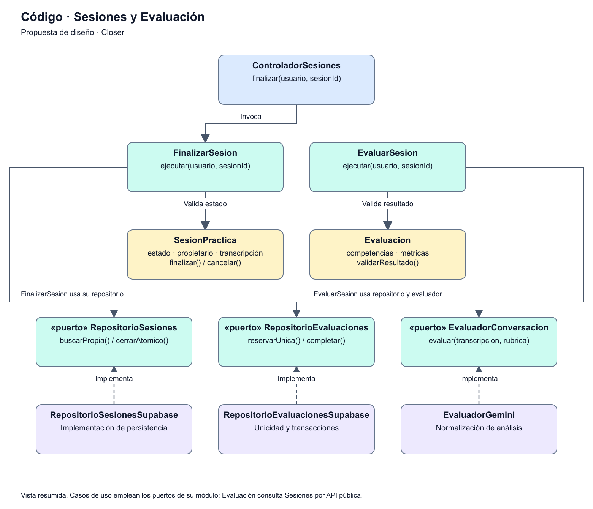
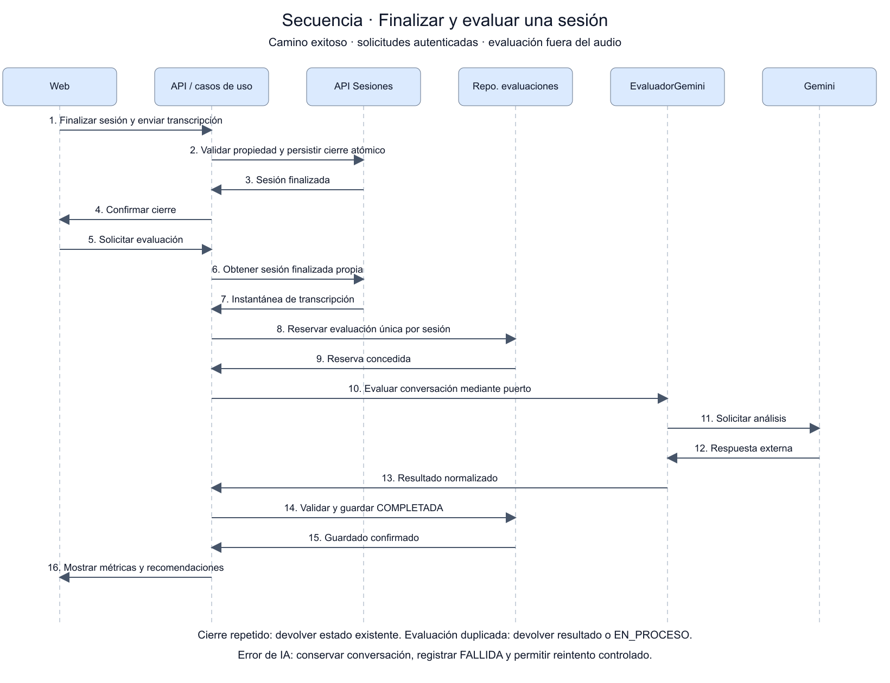

# Nivel 4 · Código: Sesiones y Evaluación

Vista propuesta de clases, contratos y colaboración. Describe el flujo finalizar y evaluar una práctica. Estos nombres no representan archivos de código implementados.

## Clases y contratos

[Fuente SVG editable](../img/fuentes-svg/nivel4-clases.svg)

| Elemento | Capa | Operación o regla |
|---|---|---|
| ControladorSesiones | Presentación | Convierte petición autenticada en FinalizarSesion. |
| FinalizarSesion | Aplicación | Verifica propiedad y solicita cierre atómico. |
| SesionPractica | Dominio | Controla estados y conserva contexto de práctica. |
| RepositorioSesiones | Aplicación, puerto | Buscar y cerrar con control de versión. |
| RepositorioSesionesSupabase | Infraestructura | Implementa persistencia de sesiones. |
| EvaluarSesion | Aplicación | Consulta sesión cerrada, reserva trabajo y coordina evaluación. |
| Evaluacion | Dominio | Valida métricas, rúbrica y recomendaciones. |
| EvaluadorConversacion | Aplicación, puerto | Contrato de análisis normalizado. |
| EvaluadorGemini | Infraestructura | Implementa integración de análisis. |
| RepositorioEvaluaciones | Aplicación, puerto | Reserva única y cambios condicionales de estado. |

En el diagrama, flecha continua significa uso o dependencia; discontinua significa implementación del contrato, como indica la leyenda. Es una vista de código simplificada; las entidades no dependen de infraestructura.

## Secuencia

[Fuente SVG editable](../img/fuentes-svg/nivel4-secuencia.svg)

El navegador cierra el audio antes de solicitar finalización. FinalizarSesion valida acceso y guarda el cierre. Luego EvaluarSesion obtiene una sesión finalizada por la API pública del módulo, reserva una evaluación por sesión e invoca el evaluador. Persistir el resultado validado precede a responder éxito. Si hay una evaluación completada se devuelve sin nueva llamada; si está en proceso se devuelve el estado. Si falla IA se registra FALLIDA y se conserva la conversación para reintentar. Las actualizaciones condicionales y una reserva con vencimiento resuelven concurrencia y recuperación.

El diagrama ilustra el camino exitoso; las ramas anteriores forman parte del contrato de diseño. La evaluación ocurre fuera del streaming y no presupone una cola.

## Patrones y principios

Adapter para IA, Repository para datos, Facade para comunicación entre módulos, SRP para separar responsabilidades y DIP para depender de contratos. Las estrategias de rúbrica, fábricas y observadores quedan sujetos a la necesidad real.

[Diseño interno](../03-diseño-de-software/diseño-interno/diseño-interno-de-modulos.md) · [Patrones](../03-diseño-de-software/diseño-interno/patrones-de-diseño.md) · [Principios](../03-diseño-de-software/diseño-interno/principios-de-diseño.md).
